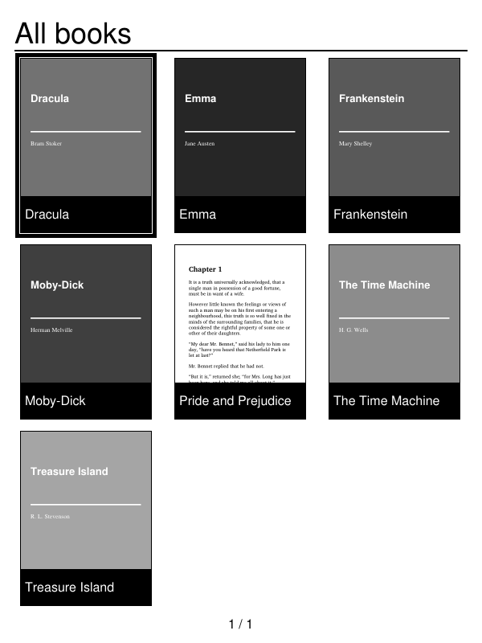
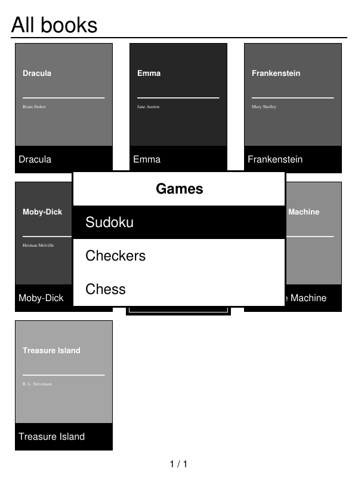
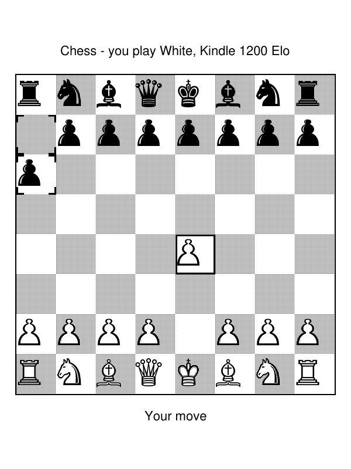
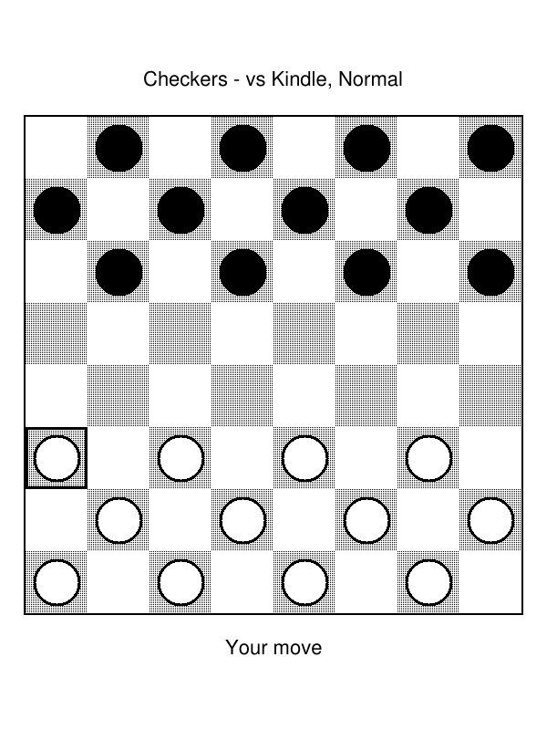
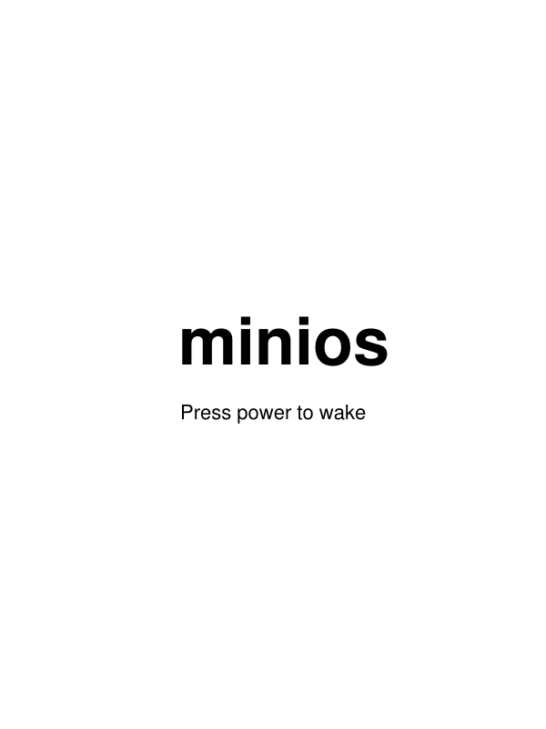

<h1 align="center">minios</h1>

<p align="center">
  <b>A tiny, calm operating system for the Kindle 5th generation.</b><br>
  It boots straight into your books. No store, no sync, no ads.
</p>

<p align="center">
  <a href="https://github.com/ywtak/minos/releases/latest"></a>
  
  
  <a href="LICENSE"></a>
</p>

<p align="center">
  
  &nbsp;
  
</p>

> [!WARNING]
> Installing minios **replaces the Kindle's system software** and has been tested on **one** Kindle only.
> It can leave your Kindle unusable. Read **[Risks](#risks)** before you start.

---

## What you get

| | |
|---|---|
| 📚 **Library** | Your books as a grid of covers. EPUB and PDF, in any folder under `books/`. |
| 📖 **Reader** | Clean EPUB reflow and fitted PDF pages, powered by [MuPDF](https://mupdf.com). Your position is saved on every page. |
| 🔌 **USB drive** | Plug into any computer and copy books on. No software needed. |
| 🔋 **Battery** | Charge in the header, and the time left at the current drain. |
| 🎮 **Games** | Sudoku, Checkers, and Chess against the Kindle with its strength set by Elo (400 to 2000). |
| 🌙 **Sleep** | After one idle minute the Kindle shows a screensaver (your own picture if you like) and goes to sleep. Press power to wake it. |

Everything minios keeps (positions, covers, game saves, a log) lives on the USB drive in a `.minios` folder, so you can see it and back it up from your computer.

<table>
  <tr>
    <td align="center"><br><sub>Menu → Games</sub></td>
    <td align="center"><br><sub>Chess, 400–2000 Elo</sub></td>
    <td align="center"><br><sub>Sudoku, three levels</sub></td>
  </tr>
  <tr>
    <td align="center"><br><sub>Checkers, vs Kindle or 2 players</sub></td>
    <td align="center"><br><sub>Screensaver while asleep</sub></td>
    <td></td>
  </tr>
</table>

<sub>Screenshots are from the PC test build (`make host`). They show exactly what the Kindle draws.</sub>

---

## Install it: the short version

This is the whole journey at a glance. Each step links to the full instructions in **[INSTALL.md](INSTALL.md)**. Plan for **1–2 hours**, and don't skip the backup.

**You need:** a Kindle 5th gen (2012, black, no keyboard) on firmware **4.1.x**, charged above 50%; a USB cable; a Windows 10/11 PC (or Linux); and about 3 GB of free space.

| | Step | What you do | You know it worked when… |
|:-:|---|---|---|
| 1 | [**Check the Kindle**](INSTALL.md#1-check-your-kindle) | Settings → Device Info. | The serial starts with `9023` and the firmware is 4.1.x. |
| 2 | [**Jailbreak**](INSTALL.md#2-jailbreak) | Copy three files from the jailbreak zip to the Kindle and restart. | A book called *"You are Jailbroken"* appears. |
| 3 | [**Turn on SSH**](INSTALL.md#3-install-usbnetwork-ssh-over-the-usb-cable) | Install USBNetwork, then log in over the cable. | `ssh root@192.168.15.244` gives you a prompt. |
| 4 | [**Back up everything**](INSTALL.md#4-install-wsl-and-make-the-full-backup) | Copy the Kindle's whole memory to your PC. | The two checksums match. Keep this file safe: **it is your only way back.** |
| 5 | [**Build minios**](INSTALL.md#5-build-minios) | `make release` in Ubuntu (WSL). | A `dist/minios/` folder appears. |
| 6 | [**Copy it over**](INSTALL.md#6-copy-the-release-to-the-kindle) | Copy that folder and your books to the Kindle drive. | The files are in `minios-flash/` and `books/`. |
| 7 | [**Install**](INSTALL.md#7-install) | Run `flash.sh install` over SSH and type `FLASH`. | The Kindle reboots into **All books**. |

**Later on:**
- **Add books.** Plug in, copy `.epub`/`.pdf` files into `books/`, eject, unplug.
- **Update minios.** Build a new version, copy it to `minios-flash/`, add an empty `DO_INSTALL` file, then eject and unplug ([details](INSTALL.md#9-updating-switching-versions-going-back-to-stock)).
- **Go back to Amazon's software.** Copy the restore images cut from your backup into `minios-flash/backup/`, add an empty `DO_RESTORE` file, then eject and unplug ([details](INSTALL.md#9-updating-switching-versions-going-back-to-stock)).

> [!NOTE]
> There are no prebuilt downloads. A minios system image contains Amazon's kernel modules, which the build copies out of **your own** Kindle's backup, so everyone builds their own. Please don't share built images.

---

## Using it

| Where | Key | Does |
|---|---|---|
| **Library** | 5-way | Move the selection. Press up from the top row to select the battery. |
| | Page keys | Previous or next page of books. |
| | Centre | Open the book (or the battery details). |
| | Menu | Games. |
| | Power | Switch off. Press again to start. |
| **Book** | Page keys or 5-way | Turn pages. |
| | Home, Back or Menu | Back to the library. |
| **Games** | 5-way + centre | Move the cursor, pick up a piece, place it. Dots show where it can go. |
| | Menu | New game, difficulty or Elo, undo, quit. |
| | Back | Put the piece down, or leave (the game is saved). |
| **Asleep** | Power | Wake up. |

**Your own screensaver:** put `screensaver.png` or `screensaver.jpg` in the root of the Kindle drive.

---

## Versions

minios is built in layers. Each layer is a git tag with its own [release](https://github.com/ywtak/minos/releases), and each one includes everything above it. See **[CHANGELOG.md](CHANGELOG.md)** for the details.

| Version | Adds |
|---|---|
| [`v1.0-bare`](https://github.com/ywtak/minos/tree/v1.0-bare) | Library, reader, USB drive mode, screensaver, power off. The best place to start a fork. |
| [`v1.1-battery`](https://github.com/ywtak/minos/tree/v1.1-battery) | Battery icon, percentage and time left. |
| [`v1.2-games`](https://github.com/ywtak/minos/tree/v1.2-games) | Sudoku and Checkers. |
| [`v1.3-chess`](https://github.com/ywtak/minos/tree/v1.3-chess) | Chess with Elo levels, and the Kindle sleeps while the screensaver shows. **Latest.** |

To build an older one, run `git checkout <tag>` before `make release`.

---

## Other devices

minios is written for **one** device, but most of it isn't tied to that device. This section explains what would carry over, and what a port would need.

### Will it run on my e-reader?

| Device | Status |
|---|---|
| **Kindle 5th gen** (2012, black, serial `9023…`) | ✅ **Supported.** This is the one it was built and tested on. |
| **Kindle 4** (2011, silver, no keyboard) | 🟡 **Probably, but untested.** Same family and hardware generation. The disk-layout check in [INSTALL step 4.4](INSTALL.md#4-install-wsl-and-make-the-full-backup) will tell you if yours differs, and key codes may need a tweak in `config.h`. |
| **Kindle Touch, Paperwhite, Oasis and later** | ❌ **No.** They're touchscreen-only with no page keys, and run newer firmware (5.x) with their own display driver setup and disk layout. A port would need new input, display and install code. |
| **Kindle Keyboard (K3) and older** | ❌ **No.** Different chip, display controller and disk layout. |
| **Kobo, PocketBook and other e-readers** | ❌ **Not as-is.** The reading, library and game code could be reused, but the display, keys, USB and installer all have to be written for that device. |
| **A normal Linux PC** | ✅ **As a test build.** `make host` runs minios in a terminal and saves each screen as `screen.pgm`. That's how the screenshots above were made. |

### How minios is put together

```
┌──────────────────────────────────────────────────────────┐
│  Library · Reader · Games · Menus      (portable C)      │  main.c library.c reader.c
│  Drawing into a 600×800 gray buffer    (portable C)      │  gfx.c games.c chess.c …
│  MuPDF for EPUB/PDF                    (portable C)      │
├──────────────────────────────────────────────────────────┤
│  Device backend                        (Kindle-only)     │  eink.c  input.c  usb.c
│  Device numbers: keys, paths, sizes    (Kindle-only)     │  config.h
├──────────────────────────────────────────────────────────┤
│  Amazon's own Linux kernel + modules   (from your backup)│  rootfs/etc/modules
│  Install / restore on the eMMC         (Kindle-only)     │  scripts/flash.sh, layout.env
└──────────────────────────────────────────────────────────┘
```

Only the bottom two layers are specific to this Kindle:

| Part | What's Kindle-specific about it | Where |
|---|---|---|
| **Display** | Lab126's `eink_fb` refresh calls (full, partial, fast area). Other devices use other drivers. | `src/eink.c` |
| **Keys** | Standard Linux input events, so they port easily. Only the key numbers change. | `src/input.c`, `K_*` in `config.h` |
| **USB drive** | The `g_file_storage` gadget, the cable-detect file, and an 8 KiB offset to the FAT partition. | `src/usb.c`, `config.h` |
| **Battery and sleep** | The `yoshi_battery` gauge in sysfs, and `/sys/power/state`. | `config.h` |
| **Kernel** | minios runs as PID 1 on Amazon's 2.6.31 kernel and loads Amazon's modules, so it's a static ARM (musl) binary. | `Makefile`, `rootfs/` |
| **Installer** | Exact partition offsets and sizes of this Kindle's eMMC. | `scripts/flash.sh`, `scripts/layout.env` |

### Porting, step by step

1. **Survey the device without changing it.** Get a root shell on its stock software and run `scripts/discover.sh`. It records the screen, keys, partitions and modules, and writes nothing.
2. **Start on the PC.** `src/host.c` is a complete backend in about 60 lines. Your device needs the same five jobs done: show the screen, refresh an area, read a key, detect the USB cable, and share the drive.
3. **Fill in `config.h`** with your screen size, key codes and paths, and keep `NOTES.md` up to date with what you've confirmed.
4. **Test from the stock system first.** Run the minios binary over SSH alongside the stock software before you replace anything.
5. **Only then write an installer.** Before that, make a verified full backup **and** prove you can restore it. A port that can't be undone is a brick waiting to happen.

---

## Risks

Please read this before installing. minios is a hobby project, and there's no support line.

| Risk | How likely | What it means |
|---|---|---|
| **Bricking** | Low if every check passes, but real | Step 7 overwrites the Kindle's system partition. If minios then fails to start *and* the USB drive doesn't appear, getting back needs the chip's USB recovery mode. Entering that mode **without opening the Kindle is unconfirmed** on this model. Worst case, the Kindle is dead for good. |
| **Losing the backup** | Up to you | The full backup from step 4 is the **only** way back to Amazon's software, and it belongs to your Kindle. Keep two copies, one outside your PC. |
| **Only tested on one unit** | — | Everything was developed and tested on a single Kindle (serial `9023…`, firmware 4.1.4). Another unit, even of the same model, may differ. |
| **Unverified steps** | — | The jailbreak and USBNetwork steps were written from community guides and haven't been re-run end to end. Sleep mode (v1.3) hasn't been confirmed on hardware yet. The log says whether it worked. |
| **No Amazon features** | Certain | There's no store, Whispersync, Wi-Fi, Kindle-format books (AZW/KFX) or DRM-protected books. Only DRM-free EPUB and PDF work. |
| **Warranty** | Likely void | Jailbreaking and replacing the system software is outside what Amazon supports. |
| **Battery drain** | Possible | If sleep doesn't work on your unit, minios falls back to staying awake, which drains the battery faster. Switch it off with Power when you put it away. |
| **Files on the drive** | Low | Unplugging without ejecting can leave the drive's file system untidy, and minios has no repair tool. Always eject first, and back up your books. |
| **Diagnostics removed** | Certain | Installing removes Amazon's diagnostics system. Restoring your backup brings it back. |

> [!CAUTION]
> If anything during installation doesn't look like the guide says, **stop**. Don't reboot after a `READ-BACK MISMATCH`, and ask for help by [opening an issue](https://github.com/ywtak/minos/issues). Remove your serial number from anything you post.

**You install minios at your own risk.** The software comes with no warranty (see [LICENSE](LICENSE)).

---

## For developers

```sh
make host test            # PC build of the UI + unit tests (Ubuntu / WSL)
make minios               # static ARM binary
make release BACKUP=...   # the full install folder, dist/minios/
```

| Path | What's in it |
|---|---|
| `src/` | minios itself. `main.c` is init and the UI loop; `library.c`, `reader.c`, `gfx.c`, and the games in `games.c` / `sudoku.c` / `checkers.c` / `chess.c`. `host.c` is the PC backend. |
| `config.h` | Every layout value, timing, Elo table and device number. |
| `rootfs/` | `/etc` of the minios system: module list, `rc.local`, mdev. |
| `scripts/` | `flash.sh` (install/restore on the Kindle), `discover.sh` (read-only survey), `layout.env` (eMMC offsets), build helpers. |
| `tests/` | Game rules and AI tests (including chess perft), and reading-position tests. |
| `docs/screenshots/` | The pictures in this README, made with the PC build. |
| `kernel/` | Headers missing from Amazon's GPL source, for the optional `make kernel`. |
| `NOTES.md` | Every hardware fact minios relies on, and how sure we are of it. |
| `CHANGELOG.md` | What changed in each version. |

## License

GPL-2.0, see [LICENSE](LICENSE). The headers in `kernel/` come from Amazon's GPL kernel source. MuPDF, downloaded at build time, has its own license (AGPL).
